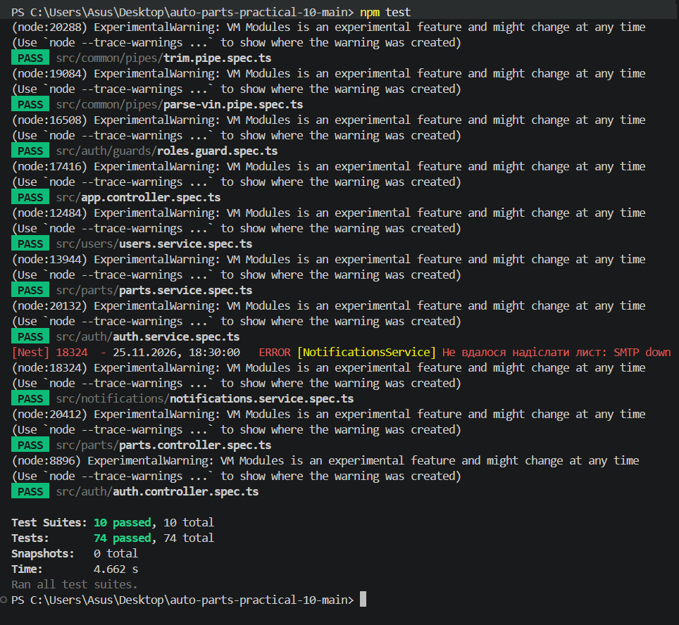
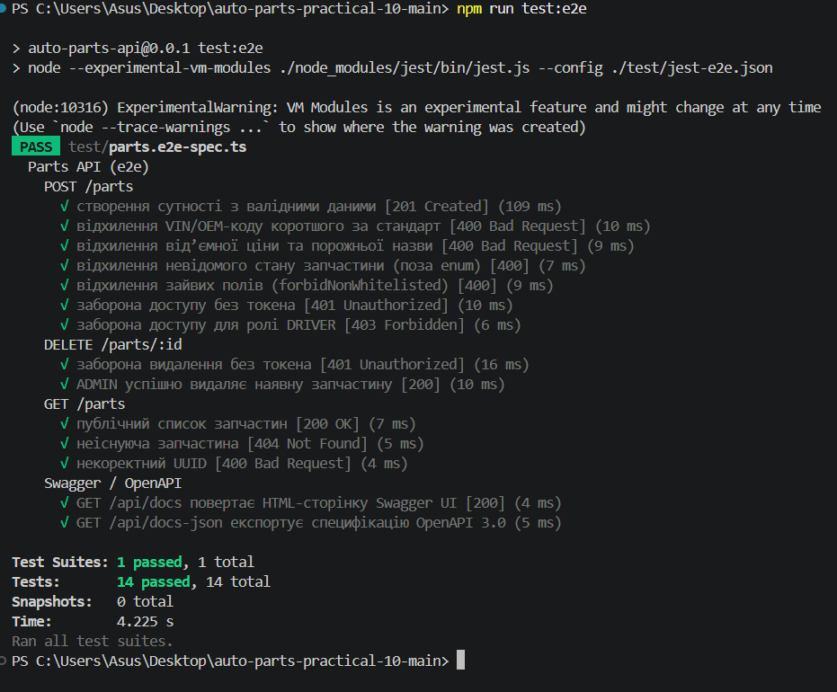
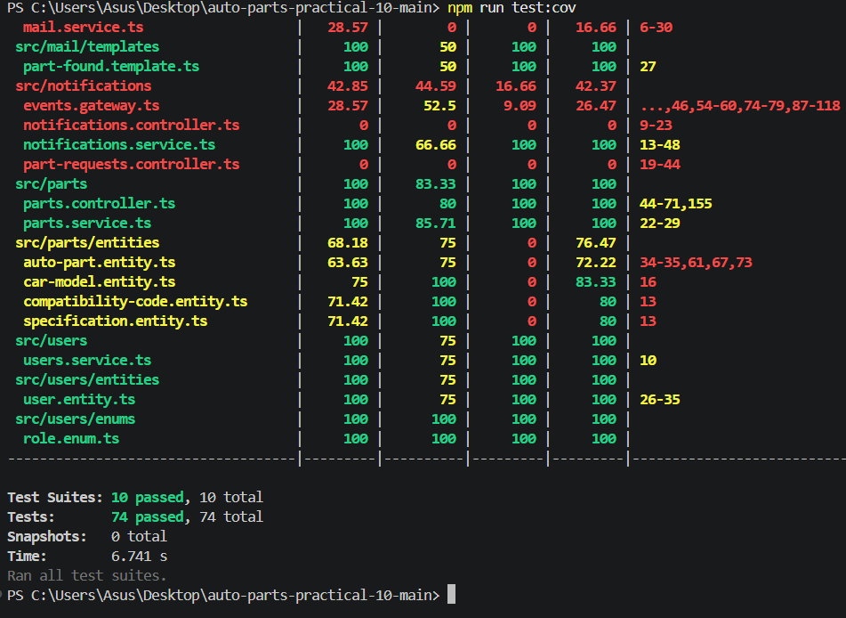
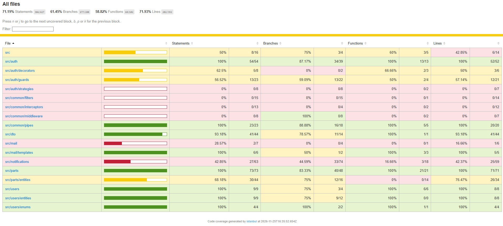
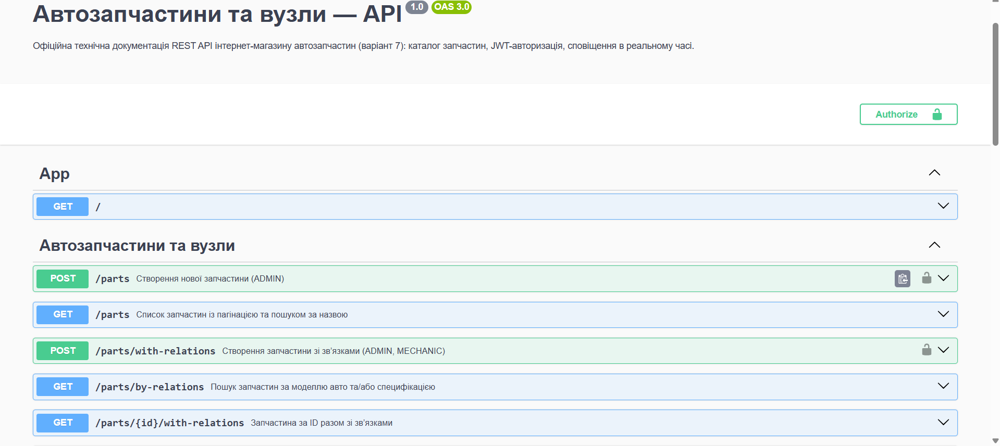
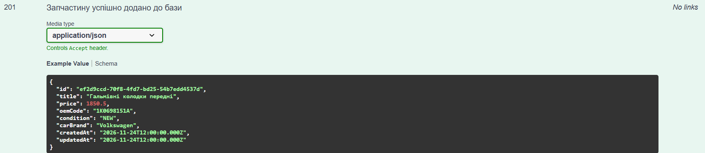

# Практична робота №11
## Автоматизоване тестування та документування API

**Варіант 7 — Автозапчастини.**
Розділ Swagger: **«Автозапчастини та вузли»** · Сутності для тестів: `PartsService`, `PartsController` (у проєкті сутність варіанта називається Parts / `AutoPartEntity`) · Граничний випадок валідації: **довжина OEM-коду менша за встановлений стандарт** (`@Length(6, 20)`).

**Мета роботи:** покрити бізнес-логіку модульними (Unit) та наскрізними (E2E) тестами на Jest + Supertest, зібрати звіт покриття коду, згенерувати інтерактивну документацію OpenAPI 3.0 (Swagger UI) із підтримкою Bearer JWT та контейнеризувати застосунок (бонус).

Проєкт є продовженням практичної №10 (NestJS, TypeORM, PostgreSQL, JWT, WebSocket, Mailpit).

---

## Використані технології
- NestJS, TypeORM, PostgreSQL, JWT (Passport)
- **Jest** + `@nestjs/testing` — модульні тести, mock-об'єкти (`jest.fn()`)
- **Supertest** — E2E-тести HTTP-конвеєра
- **@nestjs/swagger**, `swagger-ui-express` — OpenAPI 3.0
- Docker (multi-stage build)

## Що додано в цій роботі

| Файл | Призначення |
|---|---|
| `src/parts/parts.service.spec.ts` | Unit-тести сервісу: create, findAll, findOne (+/−), update, remove, restore, транзакція `createWithRelations` (успіх, 404, rollback) |
| `src/parts/parts.controller.spec.ts` | Unit-тести контролера з mock-сервісом: create, findAll, findOne, update, remove, restore… |
| `src/auth/*.spec.ts`, `src/users/users.service.spec.ts` | Тести авторизації (замість порожніх шаблонних специфікацій) |
| `src/auth/guards/roles.guard.spec.ts`, `src/common/pipes/*.spec.ts` | Тести гарда ролей та пайпів (VIN, Trim) |
| `src/notifications/notifications.service.spec.ts` | Тести сценарію «запчастину підібрано» (WebSocket + email) |
| `test/parts.e2e-spec.ts` | E2E: 201, 400, 401, 403, 404, експорт OpenAPI |
| `src/app.setup.ts` | Спільне налаштування pipes/filters/interceptors для `main.ts` та E2E-тестів |
| `src/swagger.ts` | Налаштування Swagger: `/api/docs`, `/api/docs-json`, Bearer-авторизація |
| `src/dto/*.dto.ts`, `src/dto/part-response.dto.ts` | Розмітка DTO (`@ApiProperty`, `@ApiPropertyOptional`) + схеми відповідей |
| `src/**/**.controller.ts` | `@ApiTags`, `@ApiOperation`, `@ApiResponse`, `@ApiBearerAuth`, `@ApiParam`, `@ApiQuery` |
| `Dockerfile`, `.dockerignore` | Багатоетапна збірка на `node:22-alpine` (бонус) |

Інші зміни: у DTO додано `@MaxLength` для `title` (150) та `carBrand` (80) відповідно до довжини колонок БД; `app.module.ts` читає параметри БД зі змінних оточення (значення за замовчуванням — як раніше); застарілий `test/app.e2e-spec.ts` (очікував `Hello World!` на захищеному `/`) замінено на `test/parts.e2e-spec.ts`.

---

## Запуск проєкту

```bash
npm install
npm i @nestjs/swagger swagger-ui-express   # якщо ще не встановлено

docker compose up -d          # PostgreSQL (порт 5433) + Mailpit
npm run migration:run         # міграції (потрібен .env: DB_PORT=5433)
npm run start:dev
```

- Swagger UI: http://localhost:3000/api/docs
- OpenAPI JSON: http://localhost:3000/api/docs-json
- Тестовий клієнт WebSocket: http://localhost:3000/client.html
- Mailpit: http://localhost:8025

### Тестування

```bash
npm test            # модульні тести
npm run test:e2e    # наскрізні тести (БД не потрібна)
npm run test:cov    # тести + покриття (звіт: coverage/lcov-report/index.html)
```

> E2E-тести не підключаються до PostgreSQL: піднімається справжній HTTP-конвеєр (ValidationPipe, JwtAuthGuard, RolesGuard, фільтр винятків), а TypeORM-репозиторій замінено mock-об'єктом. Це робить тести швидкими й повторюваними.

---

## Реалізований функціонал

### Рівень 1 — Базовий
- Модульні тести `PartsService` з mock-репозиторієм (`Test.createTestingModule()`, `getRepositoryToken()`, `jest.fn()`): успішне створення (перевірка `expect(mockRepo.save).toHaveBeenCalled()`), пошук за ID — позитивний сценарій та `NotFoundException`.
- Swagger у `main.ts` через `setupSwagger()`: назва, опис, версія, адреса `/api/docs`. Контролер розмічено `@ApiTags('Автозапчастини та вузли')` та `@ApiOperation`.

### Рівень 2 — Середній
- Модульні тести `PartsController`: сервіс замінено mock-об'єктом, перевіряються виклики `create`, `findAll`, `findOne` та інших методів.
- Усі DTO розмічено `@ApiProperty` (опис, приклад, тип, обмеження); усі методи контролера — `@ApiResponse` (200/201, 400, 401/403, 404).
- `.addBearerAuth()` у `DocumentBuilder` та `@ApiBearerAuth()` на захищених маршрутах; кнопка **Authorize** у Swagger UI працює.
- Покриття коду (`npm run test:cov`) — консольна таблиця та HTML-звіт.

### Рівень 3 — Просунутий
- E2E-тести (`supertest`) із глобальним `ValidationPipe`:
  - `POST /parts` з валідними даними → **201** та перевірка структури відповіді;
  - OEM-код коротший за 6 символів → **400** з масивом повідомлень (граничний випадок варіанта 7);
  - від'ємна ціна / порожня назва / невідомий `condition` / зайве поле → **400**;
  - запит без JWT → **401**; роль `DRIVER` → **403**; видалення без токена → **401**.
- Експорт специфікації OpenAPI: `GET /api/docs-json` (перевіряється в E2E-тесті).

### Бонус — Контейнеризація
- Multi-stage `Dockerfile`: етап `builder` (збірка `nest build`) → мінімальний образ `node:22-alpine` лише з production-залежностями, запуск від користувача `node`.
- `.dockerignore`: `node_modules`, `dist`, `.git`, `.env`.

```bash
docker build -t auto-parts-api .
docker run --rm -p 3000:3000 \
  --add-host=host.docker.internal:host-gateway \
  -e DB_HOST=host.docker.internal -e DB_PORT=5433 \
  -e SMTP_HOST=host.docker.internal \
  auto-parts-api
```

Змінні оточення: `PORT`, `DB_HOST`, `DB_PORT`, `DB_USER`, `DB_PASSWORD`, `DB_NAME`, `DB_SSL` (`true` для хмарних БД), `JWT_ACCESS_SECRET`, `JWT_REFRESH_SECRET`, `SMTP_HOST`, `SMTP_PORT`.

---

## Як перевірити захищені маршрути в Swagger UI

1. `POST /auth/register` → створити користувача (отримує роль `DRIVER`).
2. Видати роль адміністратора:
   ```bash
   docker exec -it nest_store_db psql -U nest_user -d store_db \
     -c "UPDATE users SET role = 'ADMIN' WHERE email = 'admin@test.com';"
   ```
3. `POST /auth/login` → скопіювати `accessToken` (діє 15 хвилин).
4. Натиснути **Authorize**, вставити токен (без слова `Bearer`) → **Authorize**.
5. `POST /parts` → **Try it out** → **Execute** → відповідь `201`. Без авторизації той самий запит повертає `401`.

---

## Скріншоти

### 1. Модульні тести (`npm test`)


### 2. Наскрізні E2E-тести (`npm run test:e2e`)


### 3. Покриття коду — консольна таблиця (`npm run test:cov`)


### 4. Покриття коду — HTML-звіт (`coverage/lcov-report/index.html`)


### 5. Swagger UI (`/api/docs`)


### 6. Авторизація через «Authorize» та захищений запит `POST /parts` → 201

---

## Контрольні питання
Відповіді для захисту — у файлі [docs/control-questions.md](docs/control-questions.md).
